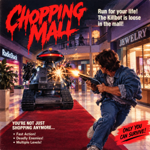

# CHOPPING MALL

[Hosted at https://hjkoskel.github.io/choppingmall](https://hjkoskel.github.io/choppingmall)

A top-down arcade survival shooter in a single `index.html`. A killer security robot hunts you through a hexagonal shopping mall after closing time. Survive three levels, one robot each, with a pistol, a shotgun and homemade firebombs, but you start with no ammunition and have to get it from the shops first.

No build step, no dependencies, no external files, no network. Open `index.html` in a modern browser and press **Enter** or **Space**.

## Inspiration: *Chopping Mall* (1986)

The game is a tribute to the 1986 B-movie horror/sci-fi film **[*Chopping Mall*](https://en.wikipedia.org/wiki/Chopping_Mall)** (originally released as *Killbots*), directed by Jim Wynorski. In the film, a shopping mall installs a new generation of automated security robots. After a lightning strike causes them to malfunction, they treat everyone left in the building after hours as an intruder, and a group of young employees has to survive the night inside the locked-down mall.

The game borrows that premise and its 1980s mood:

| In the film | In the game |
|---|---|
| A mall locked down for the night | A closed mall with six shopfronts around a central courtyard |
| Security robots that turn on the people they were built to protect | One killer robot per level that chases you and fires energy bolts |
| Survivors improvising with whatever they can find, including the mall's own shops | Shop doors restock pistol ammo, shotgun shells, gas canisters and first aid |
| Improvised weapons and fire | Gas-canister molotovs that leave burning pools on the floor |
| Neon, synths and drum machines | A synth loop with chiptune leads, bass and drums, plus victory and defeat stingers |

This is a fan homage. It uses no footage, images, audio or other assets from the film, and it is not affiliated with or endorsed by the film's makers or rights holders.

## How to play

The goal is to destroy the robot on each of the three levels without losing all three lives.

### Controls

| Key | Action |
|---|---|
| **W A S D** or **arrow keys** | Move |
| **Space** (hold) | Stop, aim at the robot and fire |
| **1** | Pistol |
| **2** | Shotgun |
| **3** | Molotov (gas canister) |
| **M** | Mute or unmute all sound |
| **R** | Restart the game |
| **Enter** / **Space** | Start from the title screen |

### Touch controls (phones and tablets)

On a touch device the game shows on-screen controls, and you can play it without a keyboard. On a laptop or desktop with a mouse and keyboard the buttons are hidden and the game plays exactly as described above. (If a hybrid laptop with a touchscreen is touched, the controls appear too.)

| Control | Action |
|---|---|
| **Joystick** (bottom left) | Move in any direction |
| **FIRE** (bottom right, hold) | Stop, aim and fire, like holding Space |
| **1 / 2 / 3** buttons | Pistol, shotgun and molotov, each showing its ammo |
| **♪** | Mute or unmute the sound |
| **↻** | Restart the game |
| **Tap the screen** | Start the game from the title screen, or play again after a game over |

You can use the joystick and the buttons at the same time. Landscape orientation gives the biggest view of the mall.

### Stop to shoot
You can't move while you fire. Holding Space freezes you in place, turns you toward the robot and starts a short aim delay of about 0.3 seconds, shown as a ring around your character. Only then does the weapon fire. Every shot costs you time that the robot uses to close the distance, so shooting means finding a gap first.

### Start empty-handed

You begin the game with **0 ammo** for every weapon. The robot waits a moment before it starts hunting you, so run to a shop door, restock, and then deal with it. Your first stop is the ammo shop right next to your starting position. Ammo carries over between levels, and nothing is refilled for free when a new level begins.

### Weapons

| Weapon | Behaviour | Max ammo (you start with 0) |
|---|---|---|
| **Pistol** | Fast, accurate shots with long range, low damage per hit | 60 |
| **Shotgun** | Six-pellet spread with short range. Heavy damage up close, and it staggers the robot | 24 shells |
| **Molotov** | Thrown gas canister that lands as a small pool of fire for about 7 seconds. It burns both you and the robot | 6 canisters |

Bullets stop at benches, plants, bins, kiosks and walls, so obstacles work as cover for you and for the robot.

### The robot

- It chases you around the ring-shaped hallway and is always slightly slower than you (roughly 72%, 79% and 86% of your speed on levels 1 to 3).
- It prefers the middle of the hallway, steers around obstacles, and reverses about three body lengths if it gets stuck before trying again.
- When it has a clear line of sight it stops, charges for a moment and fires an energy bolt. Bolts are slow enough to dodge, but they fly straight and fast enough that you can't simply outrun them.
- Its motor hums as it moves, and it clanks its claws when it spots you.
- It gets tougher each level: 30, 45 and 60 hit points, with faster movement and a shorter delay between shots.

### Damage

| Source | Effect |
|---|---|
| Robot touches you | 22 damage, with a short invulnerability window |
| Robot bolt | 12 damage |
| Standing in fire | 14 damage per second to you, 12 per second to the robot |

You start each life with 100 health. Run out and you lose a life and respawn. Lose all three and the game is over.

### Shops

Six shopfronts surround the central courtyard, each with a glowing `$` marker at its door. Walk onto a marker to restock. Each shop closes for 22 seconds after use, and won't spend a visit on something you're already full of.

| Shop | Gives |
|---|---|
| **AMMO** (two doors) | +18 pistol rounds |
| **SHELLS** (two doors) | +6 shotgun shells |
| **GAS** | +2 gas canisters |
| **FIRST AID** | +45 health |

The pistol ammo door sits right next to where you start, with a shells door on either side of it. The gas shop is further round the ring, so you have to gain enough distance on the robot to reach it and still get away.

### Scoring

- +5 points per second survived
- +10 points per hit on the robot
- +50 points per shop pickup
- +1,000 × level points for each robot destroyed, plus a speed bonus for killing it quickly

Your **best score**, along with the game duration and number of robots destroyed in that run, is saved in the browser's `localStorage` and shown in the top-right corner of the HUD.

## The mall

The hallway is a hexagonal ring around a block of shops and a fountain courtyard. A red carpet with gold trim runs down the centre of the hallway, and white checkered tiles cover the floor on both sides. Benches, potted plants, bins and kiosks are fixed in place around the ring and block movement and shots.

## Sound

Everything is synthesised live with the Web Audio API, so there are no audio files.

- **Music:** a looping 224 BPM piece ("Dm / Bb loop") with square and triangle leads, a sawtooth bass and drums.
- **Stingers:** when you destroy a robot or lose a life, the music pauses for a short victory or defeat piece and then resumes where it left off.
- **Effects:** gunshots, a molotov throw, the robot's engine hum and claw clanking, and shop pickups.

Browsers only allow sound after a key press, so audio starts when you begin the game. Press **M** to mute.

## Running and customising

1. Open `index.html` in a recent Chrome, Firefox, Edge or Safari.
2. Press Enter or Space.

All of the game lives in one `<script>` block. Most of the balance is controlled by a handful of values near the code that sets up each level and robot: the robot hit points and speed arrays, the shot interval array, the player speed (165), the ammo caps and the shop restock amounts.

To reset your saved best score, clear the site's `localStorage` entry named `shoppingMallBest` in your browser's developer tools. The key keeps the game's original name, "Shopping Mall".

## Code layout

`index.html` holds the page, its CSS and one formatted `<script>`. The script opens with a header comment that lists the sections and explains the short global names (`S` for game state, `P` for the player, `R` for the robot, and so on), and each section starts with a banner comment:

1. Canvas, geometry and tuning (the `CFG` object holds the main balance values)
2. Static background (rendered once to an offscreen canvas)
3. Game state
4. Audio (music loop, stingers, engine, effects)
5. Gameplay (movement, weapons, robot AI, per-frame update)
6. Rendering and HUD
7. Touch controls and the main loop

