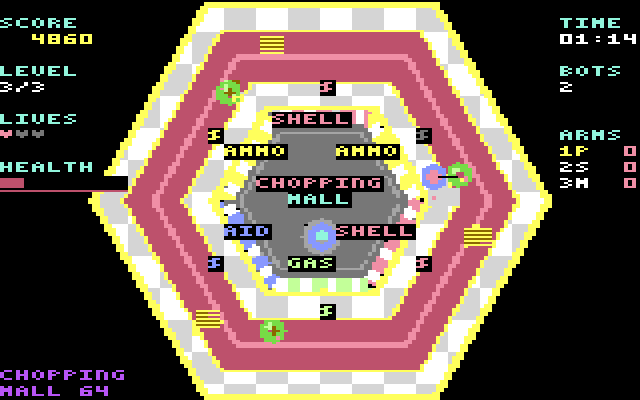

# CHOPPING MALL – Commodore 64 edition

A "tuned down" version of the game in C that compiles to a real C64 program with [cc65](https://cc65.github.io)
(tested with cc65 2.19 and the VICE emulator). It is **not** a recompile of the desktop port: that one uses
`double` maths, a 960×760 vector renderer and a Web-Audio-style synth, none of which exist on a 1 MHz 6502
with 64 KB and no FPU. The game *rules* are the same; everything around them was redesigned.

[](https://www.youtube.com/watch?v=eLL3L_sx1Ug "gameplay")

## Build and run
```
make          # build/chopping-mall.prg   (needs only cc65; `make OPT=-Os` etc. to change the optimiser)
make d64      # also build/chopping-mall.d64 with loading screen (needs c1541 from VICE)
make test     # host tests of the portable core (gcc)
x64sc build/chopping-mall.prg      # or load the .d64 on real hardware / any emulator: LOAD "*",8,1 : RUN
```
PAL timing is assumed (50 Hz raster sync, SID frequencies for 985 kHz). On NTSC the game would run ~20 % fast.

**Controls:** joystick in port 2, or `W A S D`; `FIRE` or `SPACE` = stop, aim at the robot and shoot;
`1 2 3` weapons; `M` mute; hold `P` for a second to restart; `RETURN`/fire start. **Difficulty:** level 1 offers only the pistol, level 2 adds the shotgun, level 3 adds the molotov (HUD rows and shop doors of weapons the level lacks stay dark). Ammo is scarce: you can carry at most 15 bullets / 8 shells / 6 gas canisters and a shop visit gives 6 / 2 / 2 (`AMMO_MAX`, `RESTOCK` in `core.c`; the original gave 18 / 6 / 2). The test bot no longer wins with these limits (it still reaches level 3), so the win path is tested directly. As in the original you start with **no ammo**:
the coloured `$` doors restock (yellow ammo, red shells, green gas, blue first aid).

## What changed compared with the desktop game
| | desktop port | C64 edition |
|---|---|---|
| numbers | `double`, 960×760 | 16-bit integers, positions in 1/16 px on a 320×200 field (original geometry × 0.32) |
| mall | 18 obstacles, shaken, glowing, particles | hexagon, tiles, carpet and shops painted once into a static multicolour **bitmap**; 6 obstacles, no particles/glow/shake |
| entities | unlimited bullets, bolts, fires | 8 hardware sprites: player (**multicolour** sprite: blue body, skin-coloured head, black gun barrel; colours `PLAYER_*` in `plat_c64.c`), robot (**multicolour** sprite: dark-grey rectangle body with arms out to the sides and a red-ish eye; 16 pre-rotated shapes; the eye shares multicolour register 1 with the player's head, `MC_SHARED1` in `plat_c64.c`),  3 player projectiles, 1 robot bolt, 2 fires |
| robot AI | continuous | same ideas: walks the corridor centre line round the shop block, 7-way steering, stuck detection and reverse; steering angle, waypoint and line of sight are refreshed every few ticks |
| aiming | continuous angle | 32 directions (11.25°) |
| sound | synthesised Web-Audio graph | SID: 2-voice music (lead + bass) converted from the original sequencer data, kick/snare/hat on voice 3, sound effects, and the win/lose stingers: 3-voice scores transcribed from the JavaScript game's `jingleWin()` / `jingleLose()` (brass, strings, piano, bass and the timpani roll as SID instruments; `tools/gen_jingles.py`) |
| not included | | best-score file, touch UI, particles, screen shake, music crash cymbal |

## How it is built
* `src/core.[ch]` – the whole game, portable C (no hardware, no floats). Built by **both** cc65 and gcc. One tick = one 50 Hz frame.
* `src/plat_c64.c` – VIC-II, CIA and SID. `src/plat_host.c` – silent stubs for host tests.
* `src/picture.c` – paints the background picture (160×200 multicolour bitmap + screen/colour RAM) pixel by pixel from the same geometry the rules use:
  gold trim, checkered tiles, carpet with gold edging, shop blocks with striped awnings, fountain, benches and plants, shop names and HUD labels.
  `src/mcfont.[ch]` – 3×5 pixel glyph font used for all text. `src/assets.c` – sprite shapes and a **walkability bitmap**.
  All of it runs on the host at build time (`make assets`); the generated tables are checked in (`assets_gen.h`). Doing this on the 6502 at start-up took ~45 s.
* `loading/win.koa` – victory picture shown on winning, stored packed ([docs/VICTORY_SCREEN.md](docs/VICTORY_SCREEN.md)).
* `src/loader.c`, `loading/loading.koa` – optional **loading screen** loader for the disk image; the picture is a placeholder you replace: see [docs/LOADING_SCREEN.md](docs/LOADING_SCREEN.md).
* `src/bot.c` – a tiny autopilot for tests and the `-DAUTOPLAY` demo build.

**Memory map:** program `$0801–$C485` (BASIC ROM banked out; the build fails above `$CCFF`; C stack 768 bytes at `$CD00–$CFFF`; the mall and victory pictures are stored RLE-packed). VIC bank 3 (`$C000–$FFFF`), data in the RAM *under* the I/O area and the KERNAL ROM
(the VIC always sees RAM; CPU writes land in RAM even while ROM is mapped; I/O is banked out with `$01 = $34` for the writes under `$D000–$DFFF`):
`$D000` sprite shapes · `$DC00` screen matrix (the two bitmap colours per cell) · `$DFF8` sprite pointers · `$E000` bitmap (8,000 bytes); colour RAM `$D800` holds the third colour.
Graphics: multicolour bitmap mode, background colour black. The picture is drawn once at start; during play only text/HUD cells are redrawn into the bitmap and shop doors are recoloured through colour RAM. KERNAL interrupts are off;
the program polls the raster and scans the keyboard matrix itself. Toast messages are limited to 5 characters; the health bar is 8 cells x 4 pixels = 32 steps (green above 60 %, yellow above 30 %, red below).

## Performance (measured on the emulated 6502 with the CIA cycle counter; a PAL frame = 19,656 cycles)
| | cycles |
|---|---|
| game tick, average | ~7 K (idle player chased) – 9 K (player running) |
| game tick, worst | 17–19 K |
| whole loop (input + tick + render + sound) | the bitmap build runs ≈ 86–88 % of 50 Hz with an idle player (5,248 loop iterations per 120 M cycles, 6,105 possible); the earlier character-mode build measured 95.6 % with the robot hunting the player, so the bitmap text drawing costs some speed |
What it took to get there (each step measured): `mdot` via a 251-byte table; 1-bit-per-pixel walkability bitmap instead of the geometry test (`valid()` 2,646 → ~200 cycles);
per-direction velocity tables instead of signed 16×8 multiplies (~600 cycles each); `ang32` via threshold tables; cached steering/aim angles; staggered periodic work
(nav / line of sight / shops / HUD each on their own tick phase); incremental sampling in `clear_shot`/`nav_target`; one-quarter-HUD per tick.

## Verification
* `make test` – 2.58 M invariant checks while a bot plays 5×30,000 ticks (positions stay in the corridor, health/ammo bounds, every mode visited, three levels completed) plus an exhaustive check that the walkability bitmap equals the geometry test at every pixel.
* `tools/parity.sh N` (needs VICE + C64 ROMs, `make parity`) – the host and the **real 6502 build** play the same bot for N ticks and fold the whole game state into a 16-bit hash each tick; the C64's hash is read off the emulated screen.
  Identical over 6,000 ticks (level 2, kills, shops, all weapons). This is what found the bugs below.
* Keyboard path: with `xdotool` key events into a real-time VICE run – RETURN starts the game, `S` moves the player (and picks up ammo at a door), holding `SPACE` fires (18 → 0 ammo).
* Not verified: real hardware, NTSC, the joystick port (the keyboard matrix path was), and the sound has not been *listened to* (the SID writes follow the original tables, but no audio was captured).

### cc65 pitfalls the parity test caught (worth knowing)
1. **String/char constants are PETSCII**, not ASCII: `'S'` is 211, so a naive ASCII → screen-code table garbles every letter.
2. **`unsigned char × signed char` is promoted to *unsigned* int**, so the following `>> 7` is a logical shift: a velocity of −3 became 509 on the C64 (gcc gives −3). Always widen with `(i16)`.
3. **Signed `/ 2` is compiled as an arithmetic shift** (rounds toward −∞, gcc truncates toward 0): use explicit shifts when both compilers must agree.
4. `int` is 16 bits; the core keeps every intermediate within ±32767.

## Dev options (`-D` flags, see `plat_c64.c`)
`AUTOPLAY` (+`AUTOPLAY_TICKS=n` freezes after n ticks, `AUTOPLAY_IDLE` = player idle) · `DEBUG_HASH` (state hash on screen) · `DEBUG_PERF` / `CORE_PROF` (cycle probes) ·
`DEBUG_LOOPS` (loop counter) · `NO_WALKMAP` (use the slow geometry test). `tools/vice_run.sh`, `tools/readscreen.py` drive VICE headlessly
(the Debian `vice` package has no ROMs: put `kernal-901227-03.bin`, `basic-901226-01.bin`, `chargen-901225-01.bin` in `/usr/share/vice/C64/`).
