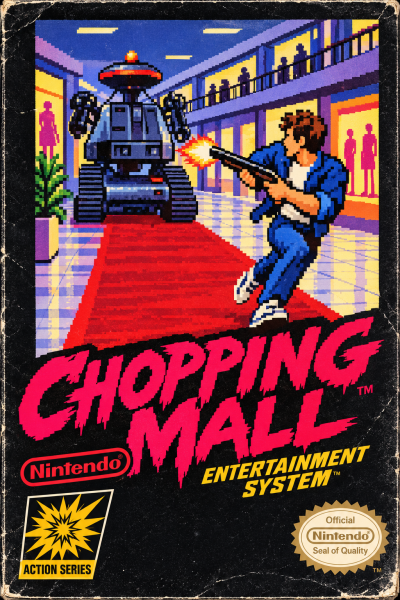
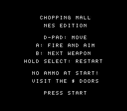
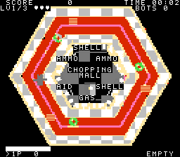
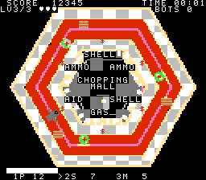
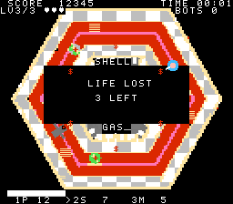

# CHOPPING MALL — NES version

[](https://www.youtube.com/watch?v=4cjTHjFHEyg "gameplay")


The same game core as the C64 version (`../chop64/src/core.c`, integer physics, 32 directions, one tick = 1/50 s), with an NES platform
layer. **NROM-256 (mapper 0): 32 KB PRG + 8 KB CHR-ROM, 2 KB RAM, no mapper tricks.** First version as agreed: **no loading screen and no
victory picture**; the C64 side panels became text rows at the top and bottom of the screen.

   

## Build / test

```
make            # build/chopping-mall.nes   (cc65: ca65 + cc65 + ld65, python3 with numpy + Pillow for the graphics)
make test       # parity: host core vs the 6502 build in fceux (bot plays 6000 ticks, state hash compared) + emulator smoke test
make shots      # screenshots into build/shots (needs fceux + xvfb)
make tables     # regenerate src/nes_tables.h      make bg   # redo the background tile conversion (2 min); outputs are checked in
```

**Controls** — D-pad move · **A** fire (hold to stop, aim and shoot; also starts a game) · **B** next weapon · **START** start ·
hold **SELECT** for one second to restart. Weapons are unlocked per level exactly as on the C64 (L1 pistol, L2 + shotgun, L3 + molotov;
doors of weapons the level lacks stay unmarked).

## What was changed in the shared core (`../chop64/src/core.c`, all behind `#ifdef NES`; the C64/host build is unchanged and still passes its tests)

| C64 / host | NES |
|---|---|
| `obg[1000]`, `rowoff*`, per-pixel walk bitmap in RAM | 125-byte obstacle-coverage grid in ROM (`NES_OBG`), the exact `valid()` test elsewhere (`NES_NO_WALKMAP`) |
| `pvx/pvy`, `b97*`, `b86*`, `clx/cly` computed at start (RAM) | `i8` tables in ROM (`src/nes_tables.h`, generated by `tools/gen_nes_tables.c` from the same formulas) |
| `rvx..rby` robot velocity tables per level (384 B RAM) | six pointers into per-level ROM tables |

Core BSS went from 2698 B to ~400 B. The whole program uses 728 B BSS + 5 B data + 31 B zero page + the 256 B OAM shadow; the cc65 stack is
the 256 B at `$0700`. PRG: 24.2 KB code + 5.0 KB data of 32 KB (about 3.4 KB free).

## Verification (what was and was not checked)

* **Logic parity:** `tools/parity.sh N` — the bot plays N ticks on the host and on the 6502 (run in fceux, state read through Lua); a 16-bit hash of the
  whole game state after every tick matches for N = 600, 3000, 6000, 12000.
* **Timing:** the core ticks 5 of every 6 video frames (60 Hz -> 50 Hz). `tools/prof.sh` shows tick + draw use ~16 % of a frame on average;
  `tools/worst.sh` (frames per `game_tick` while the bot plays) shows ~1.7 % of ticks exceed one frame, so the main loop *catches up* (it
  remembers how many frames a pass overran and runs those ticks next pass) and the game speed stays correct (594 of the ideal 600 ticks in 720 frames of idle play, including the screen changes).
* **Emulator smoke test** (`tools/smoke.sh`): title -> START -> INTRO -> PLAY, core rate, APU activity. A 24 000-frame bot run reaches level 3, ROBOT
  DESTROYED and GAME OVER without a hang.
* **Sound:** the APU register writes were logged and decoded: music lead/bass notes follow `MUS_LEAD/MUS_BASS`, the lose stinger's lead voice is
  the expected 57-62-78-81-62 sequence. *Nobody has listened to it* — pitches are right, timbre/volume balance is a guess.
* **PAL:** the region is detected at start-up by counting loop passes between two NMIs (fceux: NTSC 901, PAL 1006; threshold 950). On PAL the core ticks
  every frame (50 Hz) and the APU periods come from the PAL tables (CPU 1.662607 MHz instead of 1.789773). Checked in fceux with `--pal 1`
  (needs `SDL.AutoDetectPAL = 0` in `~/.fceux/fceux.cfg`, otherwise fceux ignores the option): 706 ticks in 720 frames, and the decoded lead notes with the
  PAL clock are 57 57 57 56 as expected. Before this fix the game ran at 5/6 speed and ~1.2 semitones flat on PAL.
* **Not done:** real hardware (NTSC or PAL), other emulators (only fceux was available).

## How it works

* `src/crt0.s` — reset, iNES header, NMI: sprite DMA + a 56-byte VRAM update list written during vblank; the main loop builds one frame and hands it over
  with `nmi_ready`. Screens (title, overlays, game over, win) are drawn with rendering off (`screen_draw`).
* **Background** (`tools/mknes_bg.py`): the C64 painter's picture without text (`gfx/pic_notext.png`, 200 x 256 after shifting 32 px left, +16 px down)
  is converted to 8x8 tiles with one of four 3-colour palettes per 16x16 block (universal colour = yellow, chosen by `tools/palopt.py` as the least
  error), then tiles are merged lossily from 352 down to 199 (cheapest pixel error first). Shop labels and the title are font tiles on black
  "plates" (palette 0), baked into the ROM nametable by `tools/mknes_assets.py`. The converted result is in `gfx/bg_preview.png`.
* **Sprites** (`tools/mknes_assets.py`): player 2x2 tiles, robot 3x3 tiles, nine rotation frames each (0..90 degrees); the other quadrants use
  the H/V flip bits (a flipped multi-tile sprite also mirrors its tile layout). Usable shop doors get a red `$` sprite instead of the C64's colour change.
  The robot's red eye has a black outline (red on the red corridor would vanish).
* **HUD:** top rows SCORE / TIME / level / lives / BOTS, bottom row weapons (`>` = selected) and a 5-character toast; the health bar is the
  8 tiles at the bottom left (32 steps, 2 px each). One quarter of the HUD per frame goes through the VRAM list.
* **Sound** (APU, stepped at the 50 Hz tick like the C64): pulse 1 lead, triangle bass, noise drums, pulse 2 sound effects (a period glide with a fading
  volume instead of the SID's frequency sweep); the win/lose stingers are the same 3-voice scores as on the C64 (`../chop64/src/jingle_gen.h`), mapped to
  pulse 1 / triangle / pulse 2 with hand-picked software envelopes (`INS_*`). No mute key yet.

## Limits worth knowing

* 190-200 distinct picture tiles is the budget (256 BG tiles minus 57 for font and bar): the diagonal edges and the ring around the shop block are the
  visibly merged spots. A mapper with CHR banking (MMC1 was offered) plus a mid-frame bank switch would remove that limit; NROM was enough for a first version.
* The region detection is a timing measurement: an emulator or flash cart that runs the NES at an unusual speed may be misdetected.
* Up to 8 sprites per scanline: player (2), robot (3), projectiles, fires and doors can exceed it for a moment; priority is player, robot, bolt, bullets, fire, doors.
* Shop names are white on black; the C64's per-shop colours do not fit the 16x16 attribute grid.
